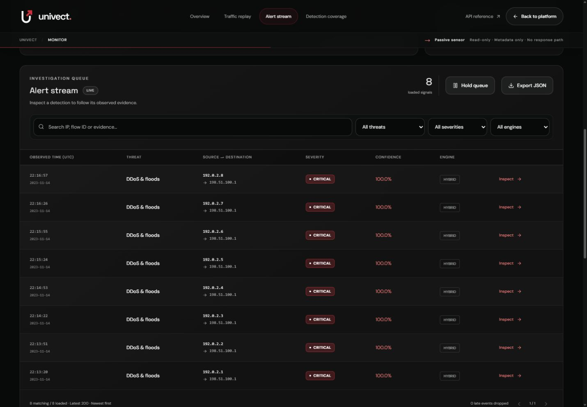

# Monitor database-read outage and recovery verification

19 October 2026 IST; baseline `135218f`. **Scoped Definition of Done: PASS.**
No product defect was demonstrated; runtime behavior stays frozen.

## Inspected and tested story

Read the preceding SQLite repair, Monitor hook/error/replay/alert-detail components,
API client, Next rewrite, local launcher and existing responsive verification.
The story is Monitor page load/polling -> production Next proxy -> real API ->
SQLite -> SSE -> retained/recovered queue. Acceptance was recorded first in
`verification/monitor-read-recovery-20261019/PROTOCOL.md`.

The owned API (18529) and production web (13529) used a disposable database and
process-only environment overrides. The verification server wrapped the real
AlertStore reads with a marker-controlled SQLite exception and recorded ASGI
status/SSE sequences. No mock response/route or product fault switch was added.
Only existing controlled transport fixtures were submitted; no attack was sent
to a monitored host and no public/reserved capture was inspected.

## Results and before/after states

Two real event-API alerts seeded SQLite. At each viewport, the already-connected
Monitor survived an induced history-read outage, retained its existing rows,
displayed Reconnecting, actionable generic storage feedback and "Showing the last
received data." Retry stayed enabled; replay and capture input were disabled.

- Desktop 1440x1000: two rows retained; two committed during outage; recovery
  displayed exactly `[4,3,2,1]`.
- Tablet 768x1024: four retained; two more committed; recovery displayed exactly
  `[6,5,4,3,2,1]`.
- Mobile 390x844: six retained; two more committed; recovery displayed exactly
  `[8,7,6,5,4,3,2,1]`.
- Page scroll widths were 1430, 758 and 380 respectively: no page overflow. The
  table's own horizontal scrolling is intentional on smaller viewports.
- Retry was exercised while the fault remained, with safe feedback; after removing
  the fault, existing polling/EventSource automatically recovered without reloading.
- A separate fresh mobile reload while reads failed showed actionable feedback
  and "Waiting for the local API." Removing the fault recovered all eight records.
  That initial state correctly did not pretend to have last-received rows.

Through the production proxy, initial alert/telemetry/stream failures were JSON
503. The actual SSE data sequence across the three catch-ups was exactly
`[3,4,5,6,7,8]`, each once, with IDs matching persistence. Successful browser stream
requests used query cursors 2, 4, 6 and 8; native Last-Event-ID forwarding was not
newly claimed from this browser run. Existing header-resume integration tests pass.
All eight durable records matched after the owned API process exited. A recovered
alert's displayed ID, flow ID and complete supporting evidence matched its saved
row. The queue was newest-first with no missing/duplicate analyst sequence.

Captured browser warning/error logs were empty. Expected HTTP 503 and server-side
injected exceptions remain in the ASGI/server traces, rather than being hidden.
The first final screenshot caught viewport/scroll transition rendering; it is
retained as `final-monitor-transition.png`. A settled desktop screenshot was
captured separately as `final-monitor.png`; DOM geometry confirmed 1440px width
and eight rows. No cosmetic change was made from that transient capture.

## Files, checks and preservation

Changed only this report, completion/progress pointers and the dated verification
protocol/controllers/receipts/screenshots. No frontend/backend, test suite, model,
dependency, dataset, schema, gate or demo-provenance behavior changed.

- Existing SQLite/read/SSE/cursor regressions: **30 passed**, one pre-existing
  Starlette/httpx warning, using project `.venv`.
- TypeScript compiler: pass. Configured production build: pass. Normal/default
  production build restored and passed after stopping the isolated services.
- Full 574-test backend and nine-scenario demo results remain the preceding
  source-matching `135218f` results; they were not rerun/relabelled here because
  runtime/tests/models did not change. No new benchmark/accuracy claim is made.
- All **130 protected original hashes** remain unchanged, including original
  analyst database/WAL/SHM, model artifacts, data contracts and demo manifest.
- Owned process trees stopped, temporary database removed after comparison,
  temporary browser tab closed and viewport override reset. Original API untouched.

There are no new unit-test cases: no code bug required a repair. The new reproducible
browser protocol, test-only controllers and actual capture constitute this task's
additional integration evidence. `freeze.json` pins the records, screenshots,
controllers, reports and the inspected unchanged runtime sources.

## Limitations and exact next task

This tests controlled read failure/recovery in one desktop browser at three
viewport sizes. It does not establish physical corruption repair, mobile hardware
coverage, concurrent-client capacity or latency. An optional Copy JSON probe showed
"Copied" in the UI, but the browser clipboard capability returned an empty string;
clipboard contents remain **UNVERIFIED**, not a demonstrated product failure or a
required storage-recovery acceptance condition. The displayed record/evidence
comparison passed independently; the clipboard observation is retained.

Freeze this passed recovery behavior; do not redesign/refactor it. Next incomplete
task is **T21 UDP pair qualification**: verify a producer runbook establishes the
same UDP service, independent flood/benign labels, original timestamps and overlapping
load before inspecting packet values. The last response check did not obtain that
prerequisite; this task neither checks mail nor assumes a reply. Until qualified
evidence arrives, that task remains blocked. DGA/DNS/TLS/C2/spoof and intent-quality
blockers are unchanged. No candidate promotion or final release READY.
